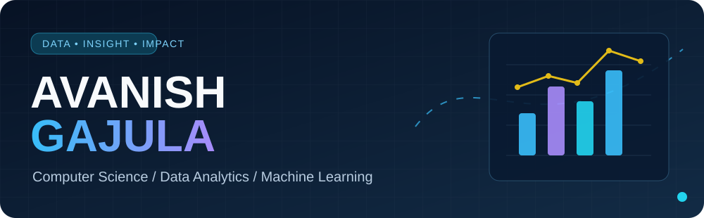
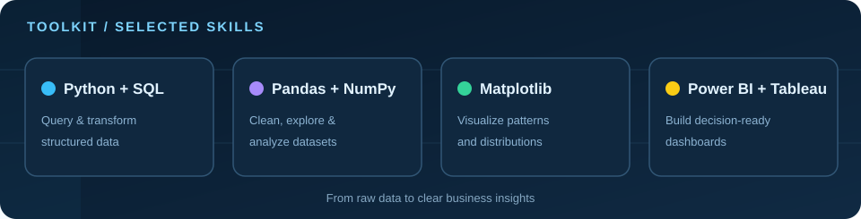

<!-- Original profile design for Avanish Gajula -->

  

  

  
  

## 👋 A little about me

I'm **Avanish Gajula**, a Computer Science undergraduate at **The University of Texas at Arlington**, graduating in **May 2027**. I'm interested in connecting data, technology, and business decisions—especially through **analytics, dashboards, and applied machine learning**.

I enjoy taking a question from raw data to a useful answer: cleaning messy datasets, exploring patterns, visualizing results, and explaining what they mean.

- 📊 **Focus:** Data Analytics · Business Intelligence · Applied Machine Learning
- 🧠 **Currently exploring:** Classification models, feature engineering, and model evaluation
- 🛠️ **Approach:** Ask good questions → validate data → analyze → visualize → communicate
- 🔎 **See my work:** [Interactive portfolio](https://avanish-gajula-portfolio.vercel.app/)

## ✨ Skills in motion

  

  

**Data analysis:** Python · SQL · Pandas · NumPy · Excel  
**Visualization & BI:** Matplotlib · Power BI · Tableau  
**Machine learning:** Regression · Decision Trees · Support Vector Machines · Classification fundamentals

## 🧭 How I approach data problems

## 🚀 Selected projects

<table>
<tr>
<td width="50%" valign="top">

### 🛍️ Retail Insights
An end-to-end retail analytics project exploring business performance and turning transactional data into interpretable insights.

**Focus:** Data cleaning · EDA · Business reporting  
[**Explore repository →**](https://github.com/avanishgajula/retail-insights)
</td>
<td width="50%" valign="top">

### 📍 Texas Job Market Dashboard
A data-focused exploration of Texas employment patterns, designed to communicate useful job-market trends.

**Focus:** Dashboards · Visualization · Data storytelling  
[**Explore repository →**](https://github.com/avanishgajula/Texas-Job-Market-Dashboard)
</td>
</tr>
<tr>
<td width="50%" valign="top">

### 🗃️ Database Management — SQL
A database-oriented project demonstrating querying, relational data concepts, and structured information management.

**Focus:** SQL · Databases · Data retrieval  
[**Explore repository →**](https://github.com/avanishgajula/database-management-sql-project)
</td>
<td width="50%" valign="top">

### 🔬 What I'm learning next
Applying regression, SVMs, and decision trees to practical prediction problems, with an emphasis on evaluation and understandable outcomes.

**Focus:** Machine learning · Experimentation · Model comparison  
[**Browse all projects →**](https://github.com/avanishgajula?tab=repositories)
</td>
</tr>
</table>

## 🎯 What I care about

> **Good analysis isn't just a chart or an accurate model. It's a useful answer to a real question.**

I'm especially interested in projects where technical work translates into better decisions. I like clear documentation, reproducible analysis, and visuals that help people understand the story behind the numbers.

---

<strong>Want to see the projects beyond the README?</strong>

Built around data, curiosity, and continual learning.

